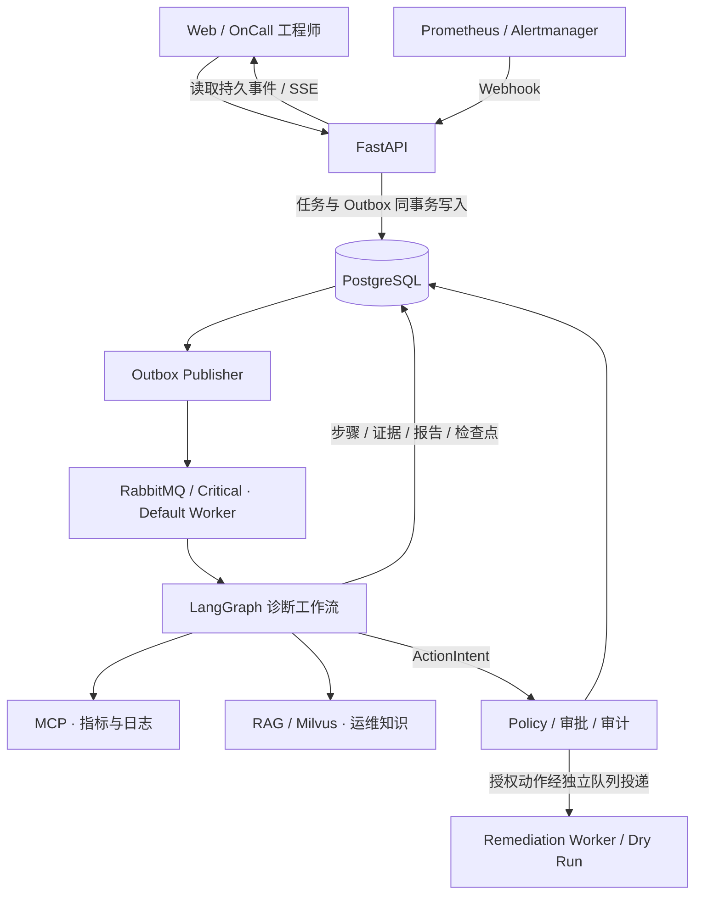

# AI OnCall

智能运维诊断平台

面向研发与运维团队的故障诊断系统，将 **告警、指标、日志与知识库** 串联到同一条可追踪的排障流程中，支持从告警触发、异步诊断到报告留存与受控处置提案。

项目围绕长任务可靠执行、证据可信性、模型权限与部署恢复设计：诊断在独立 Worker 中运行，状态与检查点持久化，浏览器断线后可继续查看同一任务。

**技术栈：** Python 3.11–3.13 · FastAPI · LangGraph · PostgreSQL · RabbitMQ / Celery · Milvus · MCP · Prometheus / Alertmanager

[快速开始](#快速开始) · [工程设计](#关键工程设计) · [验证记录](#质量与验证) · [运行手册](docs/windows-operations.md) · [接口与安全](docs/api-and-security.md)

## 无凭据重放与方案对照

想先检查项目行为，可在安装依赖后启动独立演示，无需模型密钥、云日志凭据或 Docker：

```powershell
uv sync --frozen
uv run python -m app.demo --port 9911
```

打开 [本机重放演示](http://127.0.0.1:9911)，选择 12 个合成案例之一，查看 Agent 或固定“指标 → 日志 → 总结”流程的工具轨迹、证据引用和诊断边界。终端按 `Ctrl+C` 退出。

```powershell
uv run python -m app.evaluation.compare_cli --mode replay --output-dir .runtime/comparison
```

默认重放使用脚本化模型响应，只验证流程、结果契约与引用校验，**不是根因准确率测试，也不证明 Agent 优于固定流程**。案例期望独立保存，人工复核未完成时评分为空；真实模型实验需要显式选择 `live --allow-live`，会消耗配置供应商的模型额度，本次交付不自动运行。安装、案例口径、对照参数和输出解释见 [重放与对照说明](docs/replay-and-comparison.md)。

诊断报告同时保留 Markdown 和结构化 `diagnosis_result`，区分待复核的诊断结论、证据不足、预算耗尽、依赖失败、无活跃告警及旧报告未校验。任务执行结束不代表根因已经确认。升级已有数据库前执行 `uv run alembic upgrade head`；本次新增的结果字段允许旧报告为空。

> 当前交付包含 Windows 单机托管部署与隔离恢复演练。诊断可查询真实 Prometheus 与腾讯云 CLS；处置执行器仅支持 **Dry Run**，重启、扩容和回滚动作均为模拟执行。

## 解决什么问题

故障排查通常需要在监控、日志和文档之间切换；一次模型回答也难以覆盖任务中断、重复告警、证据缺失与操作授权等问题。本项目将排障过程组织为可恢复的后台任务，并把需要确定性保证的控制逻辑放在模型之外。

- **统一排障入口**：自然语言对话、手动诊断与 Alertmanager 自动诊断；通过 MCP 查询指标与日志，支持 Markdown、TXT、PDF、DOCX 知识文档的分块、向量化与 RAG 检索。
- **持续诊断流程**：Planner 制定计划，Executor 查询证据，Replanner 根据结果调整步骤，最终保存报告、步骤和证据。
- **持久任务与实时进度**：高低优先级队列隔离，支持重试、死信重放、SSE 游标重连与页面刷新恢复。
- **受控处置提案**：模型只提交结构化意图，策略校验、审批、执行与验证由确定性状态机控制。
- **可维护的本机部署**：进程守护、独立探针、积压告警、共享模型额度、冷备恢复演练及应用版本回滚。

## 系统架构

Windows 托管模式下，API 与 MCP 运行在宿主机，数据服务、任务 Worker 和监控组件运行在 Docker 中。



**一次自动诊断：** Prometheus 告警经 Alertmanager 进入 API，任务与 Outbox 先落库；Publisher 投递消息后，Worker 领取执行租约并运行诊断。过程事件持续写入 PostgreSQL，前端按游标订阅。暂时失败进入重试，耗尽重试进入死信；处置提案独立经过证据与授权检查。

## 关键工程设计

| 工程问题 | 实现与取舍 | 代码入口 |
| --- | --- | --- |
| 数据库写入成功，但消息未投递 | Transactional Outbox 将任务与待发布事件原子写入；发布失败退避重试，消费者按持久状态幂等处理。采用至少一次投递语义 | [任务仓储](app/repositories/diagnosis.py)、[Publisher](app/workers/outbox_publisher.py) |
| Worker 重启或租约过期后，旧执行者继续写入 | 每次领取生成独立 `execution_token`；步骤、报告与检查点写入验证当前所有权，诊断检查点在同一数据库事务内加锁 | [执行器](app/services/diagnosis_runner.py)、[检查点栅栏](app/core/checkpoint_fencing.py) |
| 检索到旧版本文档，或并发替换破坏索引 | PostgreSQL 协调跨进程读写，版本记录限定可检索内容；先写入并 flush 新版本，再删除旧向量。跨库一致性通过协调协议维护 | [向量管理](app/services/vector_store_manager.py) |
| 模型建议越权，或把缺失证据当作结论 | 服务目录约束工具范围；敏感数据脱敏并限制大小；处置检查服务归属、实例、时效和证据来源，Policy 默认拒绝不满足条件的动作 | [证据校验](app/core/remediation_evidence.py)、[Policy](app/harness/policy.py) |
| 多进程争用模型额度，重试绕过预算 | PostgreSQL 共享并发租约、分钟调用次数与输入字节配额；单次诊断另有持久预算，重试不重置。当前不提供精确 Token 或金额计费 | [共享额度](app/services/shared_model_quota.py)、[数据边界](app/core/data_safety.py) |
| 浏览器断线后重复创建任务或丢失进度 | `Idempotency-Key` 创建任务，`Last-Event-ID / after_id` 恢复订阅；前端事件去重、终态防回退、账号切换清理状态 | [任务 API](app/api/aiops.py)、[前端重连](static/diagnosis-stream.js) |
| 停机、备份与发布时仍有任务写入 | 维护准入与排空后再停写；冷备恢复使用新建隔离资源；应用发布绑定不可变代码包和 Worker 镜像，回滚前检查 schema 兼容性 | [运行保障](oncall_ops/)、[操作手册](docs/windows-operations.md) |

处置控制链为 `意图 → 证据冻结 → Policy → 按模式审批 → 执行 → 验证 → 必要时最多一次回滚`。Agent 不持有基础设施写凭证，机器 API Key 不能批准处置；当前所有执行与验证均由 Dry Run adapter 模拟。

## 快速开始

**前置条件：** Python 3.11–3.13、uv、已运行的 Docker Desktop，以及有效的 DashScope API Key。接入官方腾讯云 CLS 还需要 Node.js/npm 与日志查询凭证；未配置云凭证时使用本地示例日志。

在 Windows PowerShell 中执行：

```powershell
git clone https://github.com/relievedkk/ai-oncall-diagnosis-platform.git
cd ai-oncall-diagnosis-platform

uv sync --frozen
Copy-Item .env.example .env
notepad .env
# 填写 DASHSCOPE_API_KEY 后，生成独立的本地认证凭据：
uv run python app/local_env.py --env-file .env

.\scripts\oncall-windows.ps1 start
.\scripts\oncall-windows.ps1 status
```

登录 [http://localhost:9900](http://localhost:9900)，使用 `.env` 中的 `ADMIN_USERNAME` 与首次生成的 `ADMIN_PASSWORD`。凭据生成命令不会输出密钥内容；首次配置时才复制模板，已有 `.env` 不要覆盖。

托管入口会启动数据服务、执行首次迁移、启动 Worker/Publisher、监控栈和原生 API/MCP，并检查就绪状态。运行后可上传 `aiops-docs/` 中的示例文档；为业务服务配置指标与日志映射时，编辑 [服务目录](config/service_catalog.json)。

| 入口 | 地址 / 命令 |
| --- | --- |
| Web / 登录 | [localhost:9900](http://localhost:9900) / [/login](http://localhost:9900/login) |
| 存活 / 就绪 | `/live` 公开；`/ready` 需要认证 |
| Prometheus / Alertmanager | [localhost:9090](http://localhost:9090) / [localhost:9093](http://localhost:9093) |
| RabbitMQ / Milvus 管理 | [localhost:15672](http://localhost:15672) / [localhost:8001](http://localhost:8001) |
| 独立探测 | `.\scripts\oncall-windows.ps1 probe -Once` |
| 停止托管 API/MCP | `.\scripts\oncall-windows.ps1 stop`；Docker 数据服务与 Worker 保留运行 |

Linux/macOS 开发启动、单组件排查及测试环境准备见 [开发指南](docs/development.md)；备份、隔离恢复、发布回滚和登录启动任务见 [Windows 运行手册](docs/windows-operations.md)。完整配置以 [.env.example](.env.example) 为准，API 文档默认关闭。

## 质量与验证

以下为 **2026-10-25 本地验收快照**，用于说明验证范围；GitHub Actions 的最新执行结果见 [CI](https://github.com/relievedkk/ai-oncall-diagnosis-platform/actions)。

| 验证项 | 结果与范围 |
| --- | --- |
| Python 自动化回归 | **858 passed / 4 skipped**；Windows、Python 3.13、完成 Alembic 迁移的独立 PostgreSQL 测试库；4 项为显式外部集成门控 |
| 前端回归 | **28 passed**；覆盖 SSE 分帧、断线恢复、幂等创建、刷新恢复、终态与账号隔离 |
| Docker 隔离冷备恢复 | 合成 PostgreSQL / RabbitMQ / Milvus 数据及上传文件内容比对通过，详见 [验收记录](docs/windows-operations-verification.md) |
| Windows 托管与镜像 | API / 两个 MCP 就绪、原生服务无即时重启、业务队列消费者及 Worker 镜像内服务目录检查通过 |
| 持续集成 | 配置 Ruff、Bandit、依赖审计、迁移检查、PostgreSQL 回归与 Compose 校验；具体状态以 CI 为准 |

```bash
uv sync --frozen --extra dev
uv run pytest -q
node --test tests/*.test.cjs
```

PostgreSQL 集成测试需要先在独立测试库执行迁移并设置 `TEST_DATABASE_URL`，Docker/本地依赖测试需要显式开启门控，步骤见 [测试说明](docs/development.md#测试与质量检查)。

诊断质量另外使用固定案例进行**关键词与证据存在性门禁**，检查根因词组、证据类型、报告结构与禁用结论；不将其解释为真实故障根因准确率。用户反馈、样本数与覆盖率单独统计，评测流量不计入真实使用数据，口径见 [使用反馈](docs/usage-feedback.md)。

## 项目导航

```text
app/
├── agent/aiops/       # Plan-Execute-Replan 诊断工作流
├── api/               # 对话、任务、告警、处置与认证
├── harness/           # 结构化意图、Policy 与受控 Gateway
├── repositories/      # 诊断、处置与配额持久化
├── services/          # RAG、编排、模型额度与服务目录
├── tasks/             # Celery 诊断 / 处置任务
└── core/              # 认证、证据、检查点与模型数据边界
oncall_ops/            # 守护、探针、冷备恢复、发布回滚
mcp_servers/           # Prometheus 与 CLS 工具服务
migrations/           # Alembic 数据库迁移
monitoring/           # 指标采集与告警规则
static/               # Web 界面及 SSE 重连
tests/                # Python 与 Node 回归
```

| 深入阅读 | 内容 |
| --- | --- |
| [开发指南](docs/development.md) | 跨平台启动、依赖与端口、测试、故障注入、常见排查 |
| [接口与安全约束](docs/api-and-security.md) | API 索引、认证、任务重连、处置授权与数据边界 |
| [Windows 运行手册](docs/windows-operations.md) | 部署、探测、备份恢复、共享额度、发布回滚 |
| [运行保障验收](docs/windows-operations-verification.md) | 已验证能力、演练内容与上线前待验收项 |
| [MCP 接入说明](mcp_servers/README.md) | 新服务映射、官方 CLS 网关、持续日志上传 |
| [使用反馈与统计口径](docs/usage-feedback.md) | 反馈解决率、覆盖率、耗时与模型用量 |

## 交付范围与后续工作

当前交付为 **Windows 单机运行与演练方案**：已具备持久任务、控制边界和运行保障，尚无跨主机高可用、生产规模容量与 SLO 验收，也未提供 Kubernetes / 云平台真实写入 adapter。

- **生产接入**：完成真实处置 adapter 的最小权限、威胁模型及回滚验收；在此前保持 Dry Run。
- **运行环境**：接入异机故障通知、异地加密备份与高可用组件；在脱敏业务数据副本上验证恢复与 schema 兼容。
- **容量与质量**：按实际工作负载压测、制定 SLO，积累人工标注的真实故障样本。当前没有宣称生产使用规模、MTTR 改善或根因准确率。

本地 Compose 使用开发凭据，API 为便于容器抓取指标监听宿主机接口；外部部署需配置网络隔离、TLS、密钥轮换与访问控制，具体检查项见运行手册。

## 许可证

[MIT License](LICENSE)
