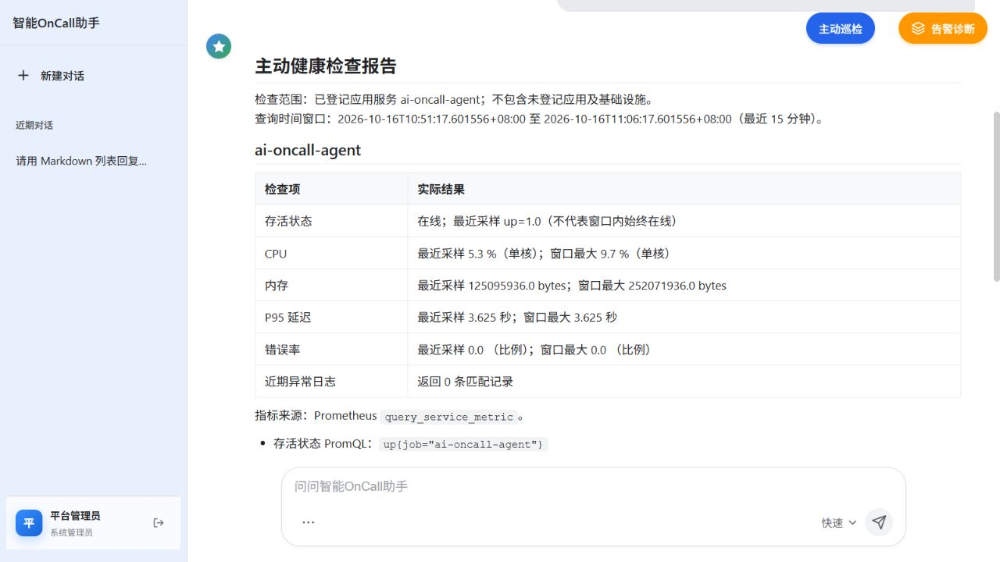

# 功能测试与修复报告

日期：2026-10-15 至 2026-10-16（Asia/Shanghai）  
项目：`D:/项目/智能OnCall Agent系统/Oncall Agent`

## 验证结果

最终自动化测试：**418 passed，0 failed，0 skipped**，耗时 68.00 秒；**app 覆盖率 67.98%**。包含真实 PostgreSQL 集成、实际 Docker 日志权限测试，以及 Python 驱动的两个 Node 前端行为用例。Ruff、Bandit、Compose 配置、Git diff 空白检查均通过；最终 Worker 镜像重新完整构建成功。

本轮采用自动化回归、真实 HTTP、浏览器操作和隔离基础设施测试。基线为 **172 passed、6 skipped，app 覆盖率 57.98%**。保留原先未提交的修改；修改前源码备份位于项目上级 `tmp/functional-test-baseline-20261015.zip`，没有备份或输出 `.env` 凭证。

真实功能检查 **60 项全部通过**，原始结果见 [functional-results-2026-10-16.json](functional-results-2026-10-16.json)。这些数量是测试检查点，不代表证明所有输入、所有并发时序或模型语义都正确。

| 功能域 | 实际验证 | 结果 |
| --- | --- | --- |
| 登录与权限 | PostgreSQL/Argon2 登录、错误密码、HttpOnly、CSRF、注销及会话撤销；无效 API Key、机器账号不能审批 | 通过 |
| 聊天 | 真实 qwen-max、普通回复、SSE、PostgreSQL 历史与清空、浏览器模式切换 | 通过 |
| 知识库 | TXT/Markdown/PDF/DOCX 的真实解析、embedding、Milvus 写入、重复上传和允许目录四格式索引；真实 RAG 找回唯一测试口令 | 通过 |
| 上传边界 | 空文件、假 PDF、未支持扩展名、越权索引路径、实际 429 限流与 Retry-After | 通过 |
| 主动巡检 | 浏览器生成表格；真实存活、CPU、内存、P95、错误率及官方 CLS 查询；空日志不等于整体正常 | 通过 |
| 手动诊断 | HTTP SSE→Outbox→RabbitMQ→Celery→模型/MCP→证据、报告落库 | 通过 |
| 自动告警 | 受控指标→Prometheus→Alertmanager→Webhook→Outbox→Worker；新任务首轮完成、18 条证据、报告落库；resolved 更新原任务 | 通过 |
| 处置审批 | SQL 测试 fixture 经真实登录/CSRF 审批、拒绝、过期 HTTP 410、重复决定 HTTP 409；真实独立队列执行 | 通过，Dry Run |
| 重试与死信 | 独立 RabbitMQ vhost 中投递预期校验失败任务；2 次领取后 dead_lettered，读取到真实死信消息 | 通过 |
| 页面 | Markdown 列表、代码高亮、历史重载 Markdown/表格、新建会话、流式回复 | 浏览器通过 |
| 部署与监控 | Worker 镜像构建、UID 10001 日志写入及本机共享目录一致性、Compose、15 条 Prometheus 规则校验及 2 组规则行为测试 | 通过 |
| 数据库升级 | 隔离库中 0007→0006→0007；Alembic schema check | 通过 |

## 已修复的问题

| 问题 | 修复后的行为 | 主要回归证据 |
| --- | --- | --- |
| 同会话重复诊断保留旧图状态、旧空告警影响新任务 | 新任务重置累加状态；聊天按账户、诊断按 diagnosis_id 隔离；仅使用最新扫描 | test_aiops_workflow、test_api_functionality |
| Executor 只执行一轮工具或把失败包装成成功 | 有界执行依赖工具调用；保留原始证据及独立错误；失败保留报告但不下发处置 | test_evidence_capture、test_aiops_workflow |
| 相同 Celery task_id 重投递，旧 Worker 仍能写入 | 每次领取独立 execution_token；心跳、事件、报告、重试与死信写入验证所有权，续约失败取消执行 | test_diagnosis_ownership、test_diagnosis_persistence |
| 失去租约的旧诊断仍能创建处置提案 | SQL 同一事务锁 DiagnosisJob 并校验有效 token/running/lease，再创建 Action/Outbox；透传 token | test_remediation_persistence、test_remediation_ownership；独立复审 |
| Worker 重试覆盖 pending checkpoint，solo 池缺少可靠总体期限 | 仅 pending 节点恢复；失败终态重新执行；使用现有 soft/hard 配置中较小正值作为 asyncio deadline | test_diagnosis_resume_deadline |
| verifying/rolling_back 中断后无法安全恢复或重复执行 | verifying 只重新观察，保留执行结果；未知结果及不确定回滚进入人工检查并熔断；旧 Worker 的状态推进被 CAS 拒绝 | test_remediation_recovery、test_remediation_gateway |
| 超时后确认失败可能被验证成成功 | 明确执行失败保持失败；准备阶段不得替换已授权目标 | test_remediation_gateway |
| 空数据、演示日志、MCP 错误被视为成功证据 | 评估与处置共用解包/门禁；所有包装层失败标记保留；指标要求有效时间戳与有限数值，日志要求非空真实记录 | test_evidence_gates、test_diagnosis_evaluation |
| 索引先删除旧文档，后续解析/嵌入/写入失败导致知识丢失 | 先准备并确认新版本，再按旧主键删除；失败清理新版本，保留旧索引 | test_index_atomicity；真实 Milvus 检查 |
| 官方 CLS 与 demo 日志契约不一致 | 适配官方 SearchLog 和本地 search_log；区分空结果/错误；显式标记 demo | test_service_observability、test_cls_demo_server |
| 聊天错误返回 HTTP 200，用户会话可相互访问，viewer 可审批 | 模型失败 HTTP 503；会话按账户隔离；仅 admin/operator 浏览器会话可审批 | test_api_functionality |
| 请求无 Content-Length 可绕过大小限制；就绪探针误判 | 按实际 ASGI body 限制；真实探测 Milvus、SQL、RabbitMQ 和两类诊断队列消费者 | test_api_functionality、test_security_hardening |
| Worker 策略/队列配置不一致，镜像重复安装项目失败 | Compose 共享处置策略、传递队列与超时；镜像冻结安装依赖，运行 uv --no-sync | test_deployment_configuration；真实镜像构建 |
| Worker 失败指标无法被 API 的 Prometheus 抓取，审批告警晚于过期 | 失败窗口从持久化证据采集；审批等待 10 分钟且持续 1 分钟后告警 | test_queue_observer；promtool 行为测试 |
| 请求速率在目录中存在，却被 MCP 工具拒绝 | schema 与运行时共享六项指标枚举；request_rate 使用目录 PromQL，0 是有效数值 | test_monitor_server、test_service_observability；真实 Prometheus |
| Executor 未保留原任务参数，模型填写示例 CLS TopicId | 每步提供原始任务和服务映射；自动诊断优先用目录驱动的 query_service_logs | test_evidence_capture；真实告警首轮完成 |
| CDN 不可用导致 Markdown 退回纯文本；高亮使用 Node 资源 | 本地固定版本、SRI 与许可文件；使用浏览器高亮资源 | test_frontend_assets；浏览器列表和代码截图 |
| 历史助手消息标为 bot，加载后当前缓存为空 | 统一 assistant 角色，兼容旧 bot 缓存，保留服务器历史；脚本版本更新避免旧缓存 | Node 行为测试；浏览器重载确认 |

## 实测中发现的非代码失败

第一轮自动诊断确实因 request_rate 和 CLS 参数问题失败，报告及错误证据保留，随后完成针对性修复。下一轮任务在旧测试重试之后排队，超过初始测试等待窗口；追加隔离消费者后，该新任务首轮成功并完成恢复闭环。没有把尚在排队或执行中的任务记作通过。

四格式重复上传的第 6 次请求触发配置中的每分钟 5 次限制，返回 429。测试遵守 Retry-After 后继续成功，没有关闭生产限流或放宽限制。

镜像构建、真实 SDK/MCP 和文件上传使用现有配置；凭证仅传给对应进程，没有写入报告。CLS 查询成功但返回 0 条匹配记录；这只证明接口与权限可用，不能证明日志采集完整。

## 使用修复

在实际应用数据库完成升级后，重启 API、Monitor MCP 和 Worker：

```powershell
uv run alembic upgrade head
docker compose -f vector-database.yml up -d --build
```

新迁移为 `20261015_0007`。数据库升级已在独立测试库验证，没有修改实际应用数据库。旧的未命名空间聊天记录仍在数据库中，新账户会话不自动显示这些记录。说明已同步到 README。

Docker 日志权限测试使用已验证的 `CLS_LOG_SPOOL_DOCKER_PATH`。此机器已配置该覆盖；Windows 路径被 Docker 映射为空目录时，必须确认容器与本机上传器实际读取同一目录。

## 边界与保留事项

- 当前适配器只有 **Dry Run**。审批/执行验证未进行任何生产重启、扩容或回滚；不宣称生产处置已验证。
- 连续 CLS 上传器的编码、重试和脱敏由自动化覆盖；本轮没有向云端上传日志，也未做长期采集完整性验证。
- Milvus 替换使用进程内共享锁，并非跨进程事务；读取者可能短暂看到新旧版本。真实断电、网络分区、跨进程竞争尚未做破坏性测试。
- asyncio deadline 对协作式异步执行有效，不能强制中断阻塞事件循环的同步代码。
- 诊断评估仍为关键词和证据可用性门禁，明确 `semantic_accuracy_verified=False`，不能视作根因语义正确率。
- 覆盖率统计只涵盖 app 自动化测试；真实 HTTP、浏览器、MCP 和 Docker 运行的额外覆盖不计入该数字。
- 测试服务已经停止，隔离卷和结果保留；没有删除用户数据库、上传文件或既有容器，没有创建提交或 PR。

## 验证材料

- [完整自动化测试 XML](pytest-results-2026-10-16.xml)
- [60 项真实功能结果](functional-results-2026-10-16.json)
- [真实模型/embedding/官方 CLS 检查](real-provider-check-2026-10-15.md)
- [真实 Milvus 检查及边界](milvus-functional-check-2026-10-15.md)
- [执行计划与记录](superpowers/plans/2026-10-15-functional-tests-and-repairs.md)


